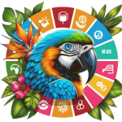
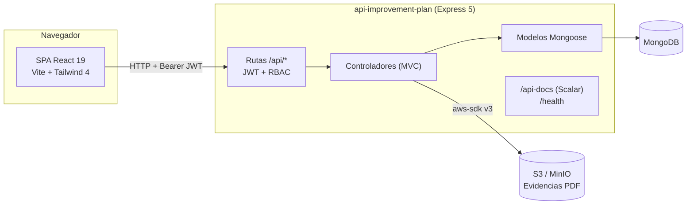

<p align="center">
  
  &nbsp;&nbsp;&nbsp;
  
</p>

<p align="center">
  <strong>Sistema de Plan de Mejoramiento</strong><br />
  Seguimiento y aseguramiento de la calidad de los programas académicos<br />
  Universidad de la Amazonia · Florencia, Caquetá, Colombia
</p>

<p align="center">
  
  
  
  
  
  
  
</p>

<p align="center">
  <a href="#qué-es">¿Qué es?</a> ·
  <a href="#características">Características</a> ·
  <a href="#arquitectura">Arquitectura</a> ·
  <a href="#stack-tecnológico">Stack</a> ·
  <a href="#inicio-rápido">Inicio rápido</a> ·
  <a href="#variables-de-entorno">Configuración</a> ·
  <a href="#api-rest">API</a> ·
  <a href="#scripts">Scripts</a> ·
  <a href="#docker">Docker</a>
</p>

---

## ¿Qué es?

El **Sistema de Plan de Mejoramiento** es una plataforma para el **seguimiento y
aseguramiento de la calidad** de los programas académicos de la **Universidad de la
Amazonia**. Permite registrar hallazgos, definir planes de mejoramiento por programa y
hacer seguimiento a las actividades y subactividades (con evidencias en PDF), a partir
de los factores, líneas y objetivos del PDI institucional.

Está construido como un **monorepo** con dos aplicaciones independientes que evolucionan
juntas:

| Aplicación | Directorio | Descripción |
|---|---|---|
| **API REST** | `api-improvement-plan/` | Backend Node.js (Express + Mongoose + MongoDB). |
| **SPA** | `front-improvement-plan/` | Interfaz web (React + Vite + Tailwind CSS). |

> Desarrollado por **[Ciides S.A.S. BIC](https://ciidesbic.org)** para la Universidad de la Amazonia.

---

## Características

<details open>
<summary><strong>Gestión integral del mejoramiento</strong></summary>

- Planes de mejoramiento por programa académico, con activación, clonado y ciclo de vida.
- Registro de **hallazgos** y **subactividades** con metas anuales.
- **Seguimiento** por año con evidencias en PDF (almacenadas en S3/MinIO).
- Exportación de matrices y planes a **Excel (XLSX)**.
- Catálogos maestros: sedes, líneas/objetivos/programas del PDI, factores de calidad
  institucional y de programa.

</details>

<details>
<summary><strong>Autenticación y seguridad</strong></summary>

- Login vía **SSO institucional** que emite un **JWT**.
- Control de acceso basado en roles (**RBAC**): `admin`, `coordinator`, `teacher`.
- API protegida con `helmet`, `cors` restringido y autenticación por middleware.
- Sesión persistida en el cliente con expiración automática (8 horas).

</details>

<details>
<summary><strong>Experiencia de usuario</strong></summary>

- SPA responsiva (escritorio y móvil) con Tailwind CSS 4.
- Tema claro/oscuro automático según preferencias del sistema.
- Rutas protegidas por rol y navegación filtrada por perfil.
- Iconografía con `lucide-react`.

</details>

<details>
<summary><strong>Operación y despliegue</strong></summary>

- Documentación interactiva de la API con **Scalar** (`/api-docs`).
- Health check en `/health`.
- Dockerfile multi-stage para el frontend (build + nginx).
- `docker-compose.yml` para levantar todo el entorno en un comando.

</details>

---

## Arquitectura



**Flujo típico:** `SPA → Axios (Bearer JWT) → Ruta → Middleware protect/authorize →
Controlador → Modelo Mongoose → MongoDB → Respuesta JSON`.

---

## Estructura del repositorio

```text
Improvement Plan/
├── api-improvement-plan/          # Backend (API REST)
│   ├── src/
│   │   ├── app.js                 # Bootstrap: middlewares, DB, rutas, docs, health
│   │   ├── config/                # envs.js, s3.client.js, swagger.js
│   │   ├── controllers/           # Lógica de negocio (MVC)
│   │   ├── middlewares/           # auth (JWT/RBAC) y manejo de errores
│   │   ├── models/                # Esquemas Mongoose
│   │   ├── routes/                # Endpoints /api/*
│   │   └── utils/                 # logger, token
│   ├── .env.example
│   ├── AGENTS.md
│   └── package.json
├── front-improvement-plan/        # Frontend (SPA)
│   ├── src/
│   │   ├── api/                   # Instancia Axios + interceptores
│   │   ├── components/            # Auth, Dashboard, Layout
│   │   ├── context/               # AuthContext (estado global)
│   │   ├── pages/                 # Páginas (General, Auth, Dashboard)
│   │   ├── App.jsx / main.jsx
│   │   └── index.css
│   ├── public/                    # Logos institucionales
│   ├── Dockerfile / nginx.conf
│   ├── .env.example
│   ├── AGENTS.md
│   └── package.json
├── docker-compose.yml             # mongo + minio + api + web
├── package.json                   # npm workspaces + scripts raíz
├── AGENTS.md · CONTRIBUTING.md · LICENSE · README.md
```

---

## Stack tecnológico

| Capa | Tecnologías |
|---|---|
| **Backend** | Node.js 22 · Express 5 · Mongoose 9 · MongoDB · JWT · helmet · cors · morgan · multer · exceljs · AWS SDK v3 |
| **Frontend** | React 19 · React Router 7 · Vite 8 · Tailwind CSS 4 · Axios · lucide-react · clsx · tailwind-merge |
| **Documentación** | Scalar (`@scalar/express-api-reference`) · swagger-autogen |
| **Infraestructura** | Docker · Docker Compose · Nginx · MinIO/S3 |
| **Herramientas** | ESLint · `node --test` · React Compiler |

---

## Inicio rápido

### Requisitos

- **Node.js >= 22**
- **npm** (se usa `npm workspaces`)
- **MongoDB** local o vía Docker
- **Docker + Docker Compose** (opcional)
- **S3/MinIO** (solo para subir evidencias PDF)

### Instalación local

```bash
# 1. Clonar el repositorio
git clone https://github.com/JanerBolivar/Improvement-Plan.git
cd Improvement-Plan

# 2. Instalar todas las dependencias del monorepo
npm install

# 3. Crear los archivos de entorno
cp api-improvement-plan/.env.example   api-improvement-plan/.env
cp front-improvement-plan/.env.example front-improvement-plan/.env

# 4. Editar los .env con tus valores reales

# 5. Levantar API + SPA en paralelo
npm run dev
```

| Servicio | URL |
|---|---|
| Frontend (Vite) | http://localhost:5173 |
| API | http://localhost:3001 |
| Documentación API (Scalar) | http://localhost:3001/api-docs |
| Health check | http://localhost:3001/health |

> También puedes ejecutar cada aplicación por separado: `npm run dev:api` o `npm run dev:front`.

---

## Variables de entorno

### Backend — `api-improvement-plan/.env`

| Variable | Obligatoria | Por defecto | Descripción |
|---|:---:|---|---|
| `PORT` | No | `3001` | Puerto HTTP de la API. |
| `MONGODB_URI` | **Sí** | — | URI de conexión a MongoDB. |
| `JWT_SECRET` | **Sí** | — | Secreto de firma/verificación de JWT. |
| `FRONTEND_URL` | No | `http://localhost:5173` | Origen permitido en CORS. |
| `S3_ENDPOINT` | No | `http://localhost:9000` | Endpoint de S3/MinIO. |
| `S3_REGION` | No | `us-east-1` | Región de S3. |
| `S3_ACCESS_KEY_ID` | **Sí** | — | Credencial S3. |
| `S3_SECRET_ACCESS_KEY` | **Sí** | — | Credencial S3. |
| `S3_BUCKET` | **Sí** | — | Bucket de almacenamiento de evidencias. |
| `S3_FORCE_PATH_STYLE` | No | `true` | `'false'` desactiva path-style. |

### Frontend — `front-improvement-plan/.env`

| Variable | Descripción |
|---|---|
| `VITE_URL_BACKEND` | URL base del backend. |
| `VITE_API_LOGIN` | URL del endpoint/API de login SSO. |

> **Nunca** se versionan archivos `.env` ni secretos. Solo `.env.example`.

---

## API REST

Todos los endpoints cuelgan de `/api/*`. Detalle interactivo en
**`/api-docs`** (Scalar) y especificación OpenAPI en `/api-docs/openapi.json`.

| Método | Endpoint | Acceso | Descripción |
|---|---|---|---|
| `POST` | `/api/users/sso-login` | Público | Login/registro vía SSO institucional. |
| `GET` | `/api/users` | admin, coordinator | Lista de usuarios (según rol). |
| `GET` | `/api/users/search` | Privado | Búsqueda de usuarios. |
| `GET` | `/api/users/coordinators` | admin | Coordinadores activos. |
| `PUT` | `/api/users/me/program` | Privado | Actualiza el programa del usuario. |
| `PUT` | `/api/users/:id` | admin, coordinator | Actualiza un usuario. |
| `GET` | `/api/programs` | Privado | Lista programas académicos. |
| `POST` | `/api/programs` | admin | Crea programa. |
| `PUT` | `/api/programs/:id` | admin | Actualiza programa. |
| `DELETE` | `/api/programs/:id` | admin | Elimina programa. |
| `GET·POST` | `/api/catalogs/*` | Privado / admin | Catálogos maestros (CRUD). |
| `GET` | `/api/activities` | Privado | Hallazgos (RBAC + plan activo). |
| `POST` | `/api/activities` | Privado | Crea hallazgo. |
| `PATCH` | `/api/activities/:id` | Privado | Actualiza hallazgo. |
| `GET` | `/api/activities/export` | Privado | Exporta plan a Excel. |
| `GET` | `/api/plans` | Privado | Planes (según rol). |
| `POST` | `/api/plans` | admin, coordinator | Crea plan. |
| `POST` | `/api/plans/:id/copy` | admin, coordinator | Clona plan y hallazgos. |
| `PATCH` | `/api/plans/:id/activate` | admin, coordinator | Activa plan. |
| `GET` | `/api/tracking/export` | Privado | Exporta matriz de seguimiento (XLSX). |
| `POST` | `/api/tracking` | Privado | Upsert de seguimiento. |
| `POST` | `/api/tracking/upload-pdf` | Privado | Sube evidencia PDF (máx. 15 MB). |
| `DELETE` | `/api/tracking/evidence` | Privado | Elimina evidencia del bucket. |
| `GET` | `/health` | Público | Health check. |
| `GET` | `/api-docs` | Público | Documentación Scalar. |

### Roles

| Rol | Alcance |
|---|---|
| `admin` | Administración total: usuarios, programas, catálogos, planes y configuración. |
| `coordinator` | Gestión de planes, hallazgos y seguimiento de sus programas. |
| `teacher` | Consulta y registro de hallazgos/seguimiento de sus actividades. |

### Modelo de datos (principales colecciones)

`User`, `Program`, `Campus`, `IdSource`, `ImprovementPlan`, `Activity`,
`SubActivityTracking`, `PDILine`, `PDIObjective`, `PDIProgram`, `FactorInst`,
`FactorProg`, `QualityInst`, `QualityProg`.

---

## Scripts

### Raíz (monorepo)

| Script | Acción |
|---|---|
| `npm install` | Instala dependencias de todos los workspaces. |
| `npm run dev` | API + SPA en paralelo. |
| `npm run dev:api` / `npm run dev:front` | Solo backend / solo frontend. |
| `npm start` | Backend en modo producción. |
| `npm run build` | Build del frontend (`dist/`). |
| `npm run preview` | Sirve el build del frontend. |
| `npm run lint` | ESLint del frontend. |
| `npm test` | Tests del backend (`node --test`). |
| `npm run docs:api` | Regenera la especificación OpenAPI. |
| `npm run docker:up` / `docker:down` / `docker:reset` | Ciclo de vida de Docker Compose. |

### Backend (`api-improvement-plan`)

| Script | Acción |
|---|---|
| `npm run dev` | Servidor con `node --watch`. |
| `npm start` | Genera docs y arranca la API. |
| `npm test` | `node --test`. |
| `npm run docs:generate` | Regenera `src/docs/openapi.json`. |

### Frontend (`front-improvement-plan`)

| Script | Acción |
|---|---|
| `npm run dev` | Servidor de desarrollo Vite. |
| `npm run build` | Build de producción. |
| `npm run preview` | Sirve el build. |
| `npm run lint` | ESLint. |

---

## Docker

Levanta **MongoDB + MinIO + API + SPA** para desarrollo local:

```bash
npm run docker:up       # docker compose up --build
npm run docker:down     # detener
npm run docker:reset    # detener y borrar volúmenes
```

| Servicio | URL |
|---|---|
| Web | http://localhost:5173 |
| API | http://localhost:3001 |
| MinIO (S3) | http://localhost:9000 |
| Consola MinIO | http://localhost:9001 |

> Las credenciales incluidas en `docker-compose.yml` son de desarrollo. Cámbialas en producción.

### Despliegue del frontend

El frontend incluye un `Dockerfile` multi-stage (build con Node 22 → nginx) y una
configuración `nginx.conf` con fallback SPA (`try_files ... /index.html`) y caché de
assets estáticos.

---

## Verificación antes de dar una tarea por terminada

```bash
npm run lint        # Frontend (ESLint)
npm test            # Backend (node --test)
npm run build       # Frontend compila
npm run docs:api    # Si se tocaron rutas del backend
```

---

## Documentación

- **[AGENTS.md](AGENTS.md)** — Guía raíz del monorepo.
- **[api-improvement-plan/AGENTS.md](api-improvement-plan/AGENTS.md)** — Detalle del backend.
- **[front-improvement-plan/AGENTS.md](front-improvement-plan/AGENTS.md)** — Detalle del frontend.
- **[CONTRIBUTING.md](CONTRIBUTING.md)** — Cómo contribuir.
- API interactiva: **`/api-docs`** (Scalar).

---

## Licencia

Software **propietario**. © Ciides S.A.S. BIC ([ciidesbic.org](https://ciidesbic.org)) para la Universidad de la Amazonia.
Consulta el archivo [LICENSE](LICENSE).
